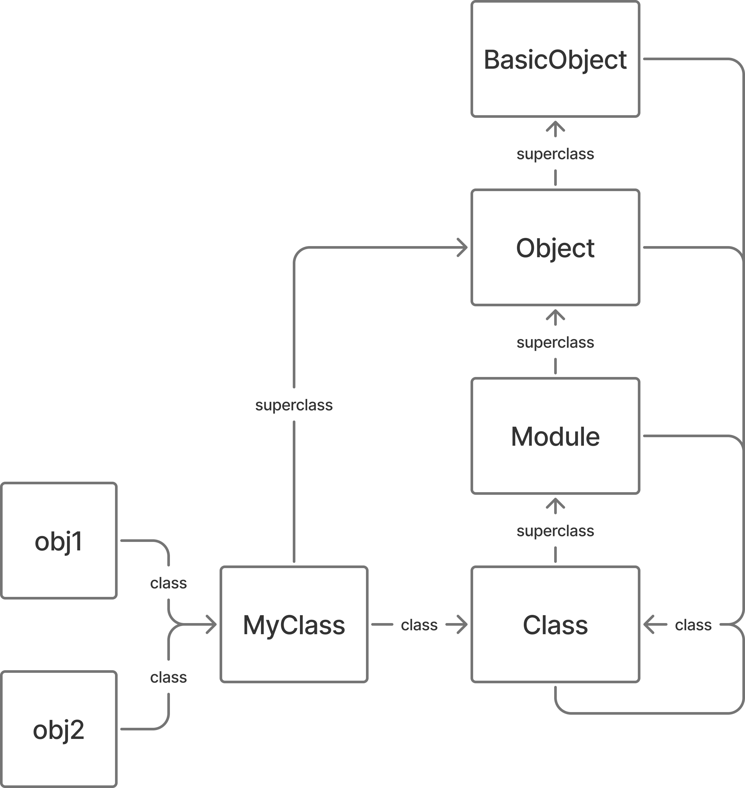

こんにちは！いとじゅんです。  
お仕事の関係でメタプログラミングRuby 第2版を読んでいるので、備忘録的なものをまとめました。

https://www.oreilly.co.jp//books/9784873117430/

まずは第2章ー

## オープンクラスの魔術

オープンクラスとは既存のクラスを再オープンして、その場で修正することができる記法。標準クラスでもいじれるぞ。

以下のコードではStringクラスをオープンして、あいさつをするメソッドを追加しています。

```ruby
class String
    def hello
        p "かぐやっほー！！"
    end
end

"超かぐや姫！".hello # => "かぐやっほー！！"
```

メタプログラミングを実現するための基礎的な機能なので覚えておくように。

ただし、既存のメソッドなどを自由に変えられてしまうので、何も考えずに修正すると予期しないバグにつながることがある。

同じような文脈でモンキーパッチというものを聞いたことがあったが書籍では以下のように記載されていた。

> なにも考えずにクラスにコードを追加してしまうと、先ほどのようなバグにつながる可能性がある。こうした暮らしへの容易なパッチに否定的な人たちもいて、このようなコードを**モンキーパッチ**という蔑称で読んでいる。

オープンクラスとモンキーパッチの使い分け？用語としての違いが私の中で曖昧ですね。オープンクラスは言語の特性？機能？でモンキーパッチはその特性を使って変更を行う行為という認識でよいのだろうか。

## オブジェクトの世界へ飛び込もう

インスタンス変数はオブジェクト内に存在する。メソッドはクラス内に存在する。書籍の図がとてもわかりやすかったですね。

すべてのクラスはオブジェクト。すべてのクラスはモジュール。うーん頭パンクする、と思ったので書籍の図を拡張したバージョンを作ってみました。



Rubyのあらゆるオブジェクトは何かしらのクラスのインスタンスなので、ClassクラスもClassクラスのインスタンスということ？混乱してきた。

## メソッドの旅

Rubyでメソッドが呼び出されたとき、継承チェーンに従ってメソッド探索を行う。最初に発見されたメソッドが実行される。

あらゆるオブジェクトは何かしらのクラスのインスタンスなので、まずは自身のクラスのインスタンスメソッドを見に行く。そこで見つからなければ、継承チェーンに従ってBasicObjectまで探索する。

```ruby
p MyClass.ancestors # => [MyClass, Object, Kernel, BasicObject]
```

Kernelって誰よ！！さっきの図にはいなかったじゃない！！

継承と言われるとクラスのイメージが強いが、継承チェーンにはモジュールも含まれる。あるクラスでモジュールに取り込まれると継承チェーンに挿入される。

include句だとそのクラスの継承チェーンの真上に、prepend句だとそのクラスの継承チェーンの真下に挿入される。

この挙動面白い。prependしたらそのクラスのインスタンスのはずなのに、継承チェーン的には先にprependしたモジュールが優先される。実用することはないかなー。うちのプロダクトで使っているか見てみよう。

```ruby
module KG
  def hello
    "かぐやっほー！！"
  end
end

class YC
  prepend KG

  def hello
    "ヤオヨロー！！"
  end
end

cpk = YC.new
puts cpk.hello# => "かぐやっほー！！"
```

## privateの正体

Rubyのprivateは二つのルールによって実現されている。

1. 自分以外のオブジェクトのメソッドを呼び出すには、レシーバを明示的に指定する必要がある
2. privateのついたメソッドを呼び出すときにはレシーバを指定できない

このルールによって、Rubyのクラスのprivateメソッドはサブクラスからも呼び出せる。レシーバを指定しなくてもいいから。

書籍の例だとselfキーワードがついているので動かないというものだが、Ruby 2.7以降はselfキーワードがついていても動くらしい。自分の環境(ruby v4.0.3)では。書籍の例のコードでも動いてくれた。

https://qiita.com/pink_bangbi/items/e0bc9b0ed19fad28bdd0

## Refinementsでご安全に

読み進めていく中でも思っていたが、Stringクラスのような標準クラスをグローバルに変更するのはさすがに危険。そこでRefinements。

```ruby
module KaguyaExtensions
  refine String do
    def hello
      "かぐやっほー！！"
    end
  end
end

using KaguyaExtensions

puts "超かぐや姫！".hello # => "かぐやっほー！！"
```

影響範囲を限定できてうれしいね。上のコードだと全然影響範囲を限定できていないですが、本来はソースファイルやモジュール内でusingすることで、限られた空間上で有効になる。

## おわりに

なにかを学んだあと、皆さんならどうしますか？私はやはり演習だと思うんですよね。メタプログラミングRubyで学んだものをそのまま使って問題が解けるリポジトリがあるんですよね！！おすすめです。

https://github.com/kinoppyd/reading-metaprogramming-ruby

改めて感想ですが、2章だけでもはじめましてな概念が大盛でとても楽しい！！メタプログラミングという魔術の最初の一歩、メラを覚えた気になってきた。

3章以降も記事にしたいと思っているので、読んでみてほしいです！

ではまた。
