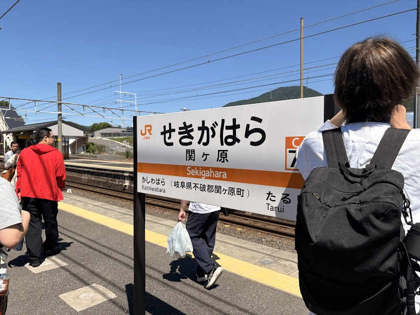
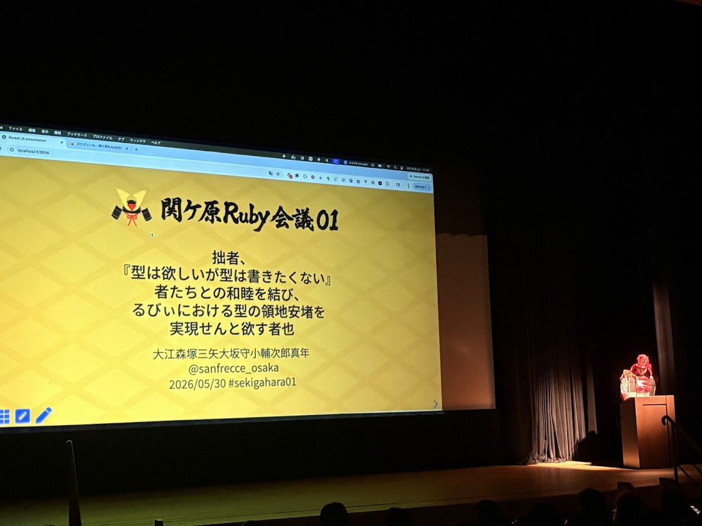
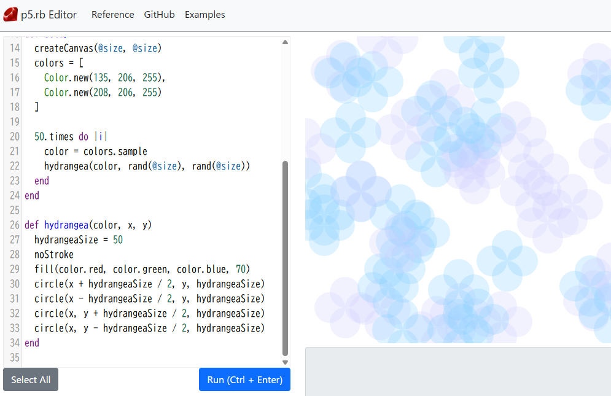
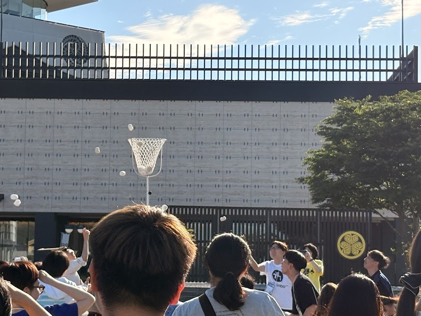
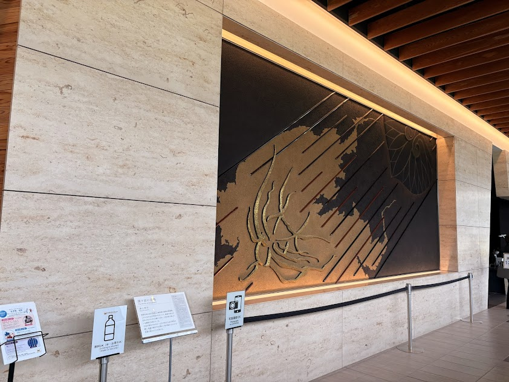
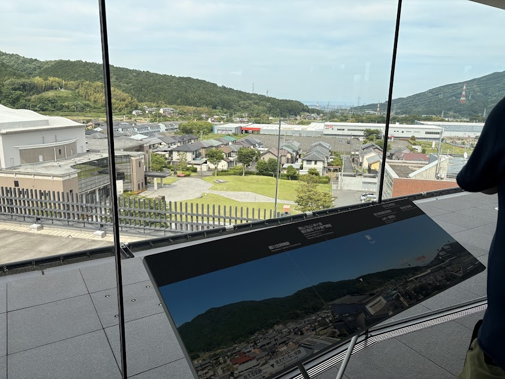

こんにちは！いとじゅんです！  
2026年5月30日に開催された関ケ原Ruby会議01に参加したので、体験が新鮮なうちに参加レポートを書きました！

関ケ原に降り立ったRubyistたち

## 印象に残った発表

関ケ原Ruby会議01で印象に残った発表をいくつか紹介します！

### **拙者、『型は欲しいが型は書きたくない』者たちとの和睦を結び、るびぃにおける型の領地安堵を実現せんと欲す者也 (森塚三矢大阪守真年** [**@**sanfrecce\_osaka](https://x.com/sanfrecce_osaka)**)**

セッションの写真(甲冑着てるの好き)

そもそも型の必要不必要の話をするときの認識を揃えるため、人々が型と言う時に何を指しているのかを整理しておられていたのが良かったです。私は、「型は欲しいけど、その技術の慣習に合わしたらいいんじゃね」というあってないような思想を持っています。ただ、ここでいう型が何を指しているのかが言語化できていないので、このセッションの内容は大変参考になりました。定期的に資料を見返して、型に対する思想を強化していきたいと思いました。

### **気づいたらRubyで100作品 ー クリエイティブコーディングが生活の一部になるまで（橘小芝内匠頭緒美三幸** [@chobishiba](https://x.com/chobishiba)**）**

クリエイティブコーディングとの出会いから挫折、現在に至るまでの話をされていました。私は大学の授業でProcessingをやっていたので、知ってはいましたが、クリエイティブコーディングの世界の広さを知ることができました。

私もRubyでクリエイティブコーディングを試してみたいと思い、以下のようなコードを書いてみました。一応テーマはアジサイです...。たのしい

p5.rbでクリエイティブコーディングを試してみた

### RubyKaja 2026

Rubyコミュニティへ貢献されている方を表彰する催しがされていました。私がオーガナイザーをしているVRChat.rbに参加してくださっている、すぎうりさんとMakiさんがノミネートされておられ、すぎうりさんはスピーチもされていました。ノミネートされている方々はそれぞれの形でコミュニティに貢献しておられ、私も引き続きRubyのコミュニティにお客さん以上の気持ちで参加していこうと思いました。

## そのほか

合戦(玉入れ)がありましたね。Rubyistたちと籠攻めをするのがとても楽しかったです！西軍の勝利！！！！！私は東軍から西軍に寝返ったので勝ち！！！！！！！

合戦の様子

二次会に行こうと思ったら、VRChat.rbから連れてきた学生さんがインシデントを発生させ、巻き込まれていました。マジで面白かった。旅にはインシデントが必要だよな！

> 電車の椅子にカバンの紐挟まれて尾張一宮まで来た人+巻き添え1名 [#sekigahara01](https://x.com/hashtag/sekigahara01?src=hash&ref_src=twsrc%5Etfw) [pic.twitter.com/cAe5FvIQGZ](https://t.co/cAe5FvIQGZ)
> 
> — いとじゅん (@itojum1230) [May 30, 2026](https://x.com/itojum1230/status/2060686134267781226?ref_src=twsrc%5Etfw)

Rubyistたちと関ケ原古戦場記念館に行ってました。関ヶ原の戦いの知識がつきましたね。関ヶ原の戦いのムービーを見たのですが、席が揺れたり風が吹いたりしていてアトラクションすぎた。こういう施設に来ることがあまりないので、これからはいろいろ回りたいと思いました。

展望台から見た景色が最高でしたね。あの丘にあの将軍の陣地があったのか～となっていました。よかった。

関ケ原古戦場記念館の入り口

関ケ原古戦場記念館の展望台

## おわりに

関ケ原Ruby会議01めちゃくちゃ楽しかったです！私がVRCHat.rbから連れてきたエンジニアたちもめちゃくちゃ楽しかったと言ってくれたので、それも良かったです！

本編や懇親会でプロポーザルのやっていきが高まったので、ちょっとプロポーザルを出すために取り組んでいきます！KaigiEffectを感じる。

ではまたー
