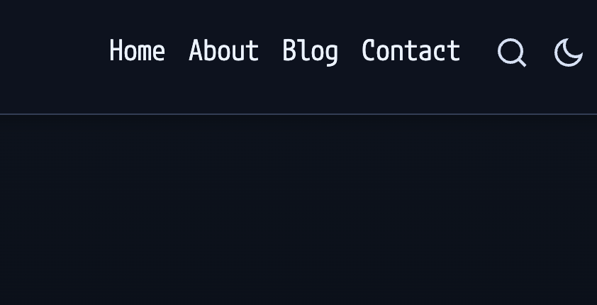
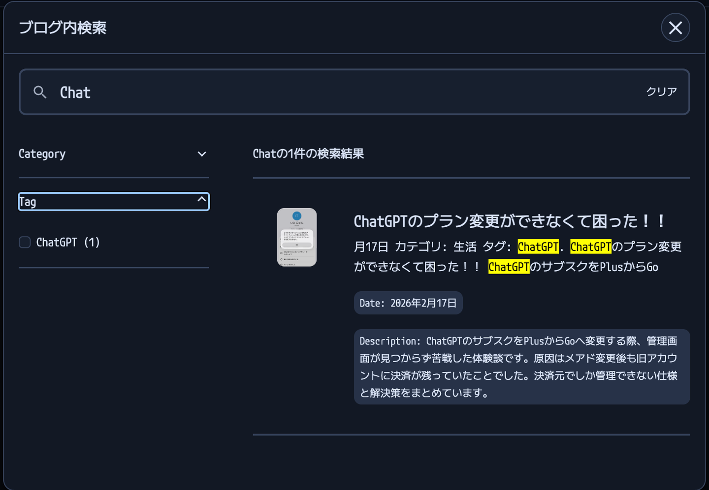

## 結論

- buildのformatをfileにすると、`Astro.url.pathname`の末尾に.htmlが付くので、パスと一致しなくなってカレント表示が壊れた。
- .htmlをreplaceして解決。

## 何が起こったか

ホームページが形になってきたので、astro previewでビルドされたサイトをブラウザで見ようとしたところ...


ローカル開発サーバー上のホームページのヘッダーリンク

きちんと動いていたはずのヘッダーリンクのカレント表示機能が



preview環境のカレント表示が壊れたヘッダーリンク

見るも無惨な姿に...。これはナビゲーションにないページにいるわけではなく、どちらもAboutページのスクリーンショットです。

このカレント表示機能は、Astro公式のブログのテンプレートをそのまま流用させてもらったものなので、何が起こってるのか一瞬わかりませんでした。

## 原因

このバグの原因は、私がAstroのbuild formatをfileに変更していたことでした。このホームページには検索機能があるのですが、Pagefindというライブラリを使っています。



Pagefindによる検索機能

Pagefindを導入するときに以下の記事を参考に構築したのだが、あまり設定を理解せずに実装したのが今回のバグの原因だった。

[https://blog.eno1220.dev/posts/pagefind-astro](https://blog.eno1220.dev/posts/pagefind-astro)

Astroの公式ドキュメントで調べてみる

> `'file'`: Astro will generate an HTML file named for each page route. (e.g. `src/pages/about.astro` and `src/pages/about/index.astro` both build the file `/about.html`

[https://docs.astro.build/en/reference/configuration-reference/#buildformat](https://docs.astro.build/en/reference/configuration-reference/#buildformat)

この設定を外してbuildしてみると確かにカレント表示が直っていた。

## 解決

.htmlが末尾についてしまって、一致しなくなっているっぽいので、.htmlを空文字列で置き換えてみました。

```typescript title="元のコード"
const pathname = Astro.url.pathname.replace(import.meta.env.BASE_URL, "");
const subpath = pathname.match(/[^/]+/g);
const isActive = href === pathname || href === `/${subpath?.[0] || ""}`;
```

```typescript title="修正後のコード"
const pathname = Astro.url.pathname
 .replace(import.meta.env.BASE_URL, "")
 .replace(/\.html$/, "");
const subpath = pathname.match(/[^/]+/g);
const isActive = href === pathname || href === `/${subpath?.[0] || ""}`;
```

この修正によってカレント表示機能が正常にビルド後でも動くようになりました。

## 最後に

今回の教訓は設定した項目によってどういう挙動になるのかしっかり把握しておきましょうねですね。開発環境での挙動では正常で、ビルド後は壊れるというのがうん？となった原因でしたが、割とよくあることだと思うので気をつけていきたいところ。
