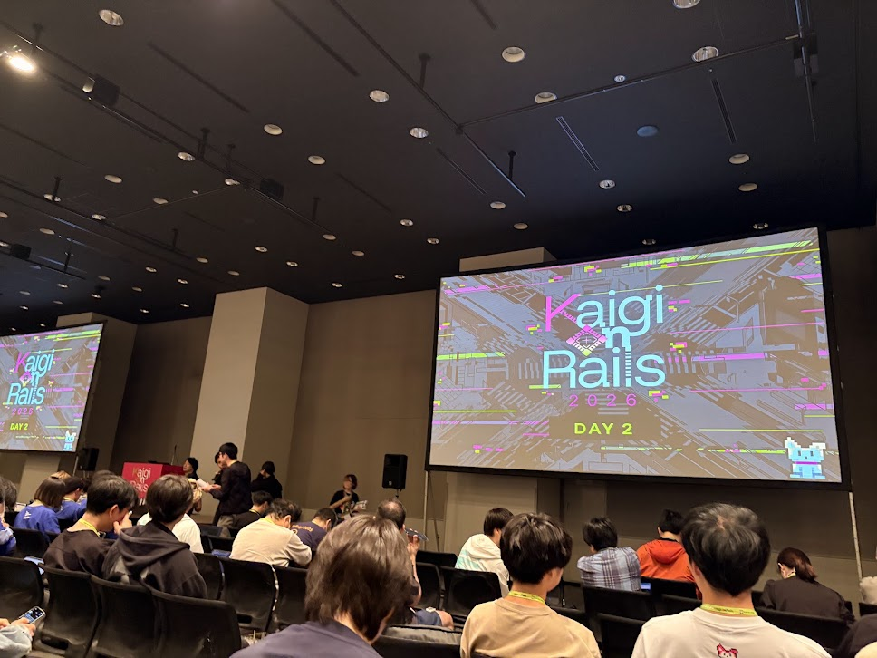
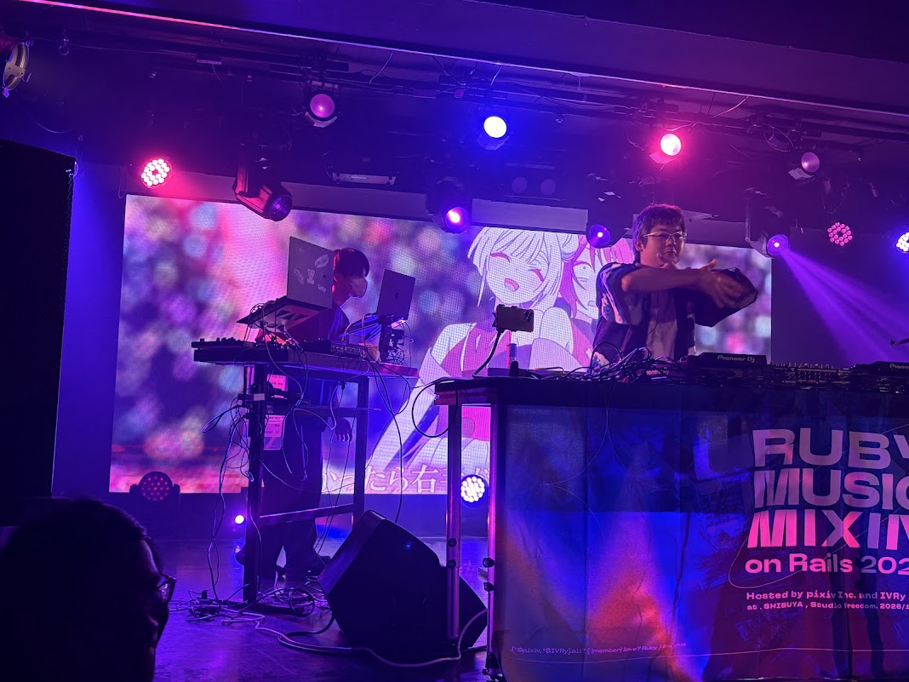

こんにちは！いとじゅんです。

2026年10月16日、17日に開催されたKaigi on Rails 2026に初参加してきました！Kaigi on Rails 2026はRuby on Railsをテーマにした技術カンファレンスです。業務上の知見やRailsのコアなどについての発表が盛りだくさんのとても楽しいカンファレンスでした。

この記事では、Kaigi on Rails 2026のセッションや感想などをお届けします！

https://kaigionrails.org/2026/

Kaigi on Rails 2026の様子

## **特に印象に残ったセッション**

どのセッションも面白かったのですが、ここではセッションやLTの中から特に印象に残ったものを4つご紹介します！

### **Railsバージョンを4倍にした話 〜Rails 2系から8系へ〜 (**[**skytomo221**](https://github.com/skytomo221)**)**

このセッションでは、長く手が入らず経緯も忘れられていｗたプロダクトを、Rails 2からRails 8、Ruby 1からRuby 3まで一気にアップグレードした事例が紹介されていました。4倍と3倍はやばい。

セッションの中心は、実装そのものよりもその前の調査段階を主に話されていました。仕様書と実態に乖離があったり、本番ブランチがなぜか「sakura」だったりと歴史的経緯を紐解いていく考古学的なアプローチが面白かったです。実際にバージョンを上げるときにも、Rails 2の環境構築やテストの追加などをAIも活用しながら行っておられました。

ちなみに、このセッションを発表されていたskytomoさんは私がオーガナイザーをやっているVRChat.rbの常連でアイコンも作ってくれた方です。これは応援しに行かなきゃと思って最前列で見ていました。

発表資料はこちらです！

https://speakerdeck.com/player/9c91a64cf8a04f8891637fafb959793d

### 全ての永続トークンを、生まれる前に消し去りたい！([sylph01](https://github.com/sylph01))

このセッションでは、Webサービスに埋め込まれがちな「無期限（または長寿命）で、強い権限を持つトークン」をなくすための考え方と手段が紹介されていました。トークンを「誰の権限か」と「人間が待っているかどうか」で整理し、システム間連携では Client Credentials Grant を使うこと、強い権限を避けることなどが解説されていました。

ルールとして永続トークンは良くないよねというのは認識していたのですがこのセッションで再整理できて学びになりました。実際に業務で使えるような話も多かったのですが、まだ理解しきれていないところが多すぎるので、資料を読み直していこうと思います。

その資料はこちらになります。

https://speakerdeck.com/player/732df7b1f8794db78e6eb8a2415bbd7c

### 作れる、でも消せるか？──安全に「枯らして消す」機能削除術([ksbmyk](https://github.com/ksbmyk))

このセッションでは、「使われていないと言い切れない」機能を安全に消すための「枯らして消す」アプローチを、スマートバンクさんでミッション機能を実際に削除した事例とともに紹介されていました。枯らして消すまでの手順を4段階に分けて説明しておられました。

私も会社では様々なところに影響するような基盤を開発しているので、もしBreaking Changeな変更を入れるときには、このセッションの枯らして消すという知見が大いに活用できるため、とても参考になりました。

https://speakerdeck.com/player/3a30d026b2c54f36a5cf99ee02ab87a8

### Web Framework Benchmark Battle 2026, Any%([amatsuda](https://github.com/amatsuda))

このセッションは、ベンチマークで不遇な扱いを受けているRailsを救ってくれるセッションになるかと思いきや、RailsWorldのDHHショックを受けて急遽、SpinelでRailsを動かすためのライブラリを作りその話をされていました。

私もMatzのキーノートで言っておられた、Roundhouseを使ってSpinel on Railsは難しいんじゃないかなと思っていたので、ナウな話題でした。Pinesには期待ですね。いろいろな意味で時代の移り変わりを感じるセッションでした。

https://speakerdeck.com/player/50d4012fbddf47dd8cfcbb80b23fdba5

## 全体の感想

セッションだけでなく、スポンサー各社のブースやサブイベント等もとても楽しい最高なカンファレンスでした。実務的な話が聞けるRubyのカンファレンスはなぜか珍しいので新鮮でした。今後の業務に直接活きるような学びが多くてとても良かったです。

サブイベントだとRubyMusicMixinが最高に最高でした。私の趣味にドンピシャでずっと興奮していました。

控えめに言って神

オーガナイザー・登壇者・スポンサー・参加者の皆さま、ありがとうございました！
