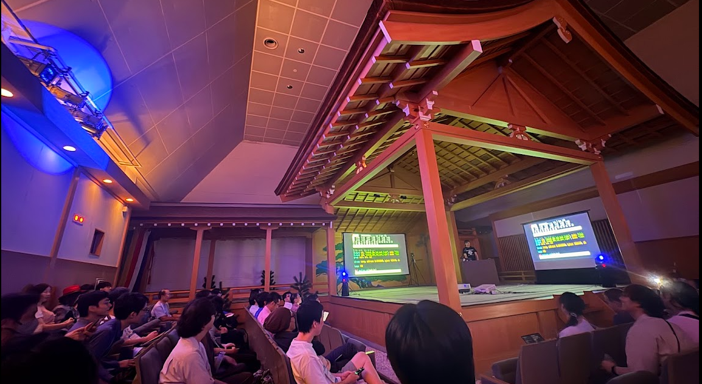
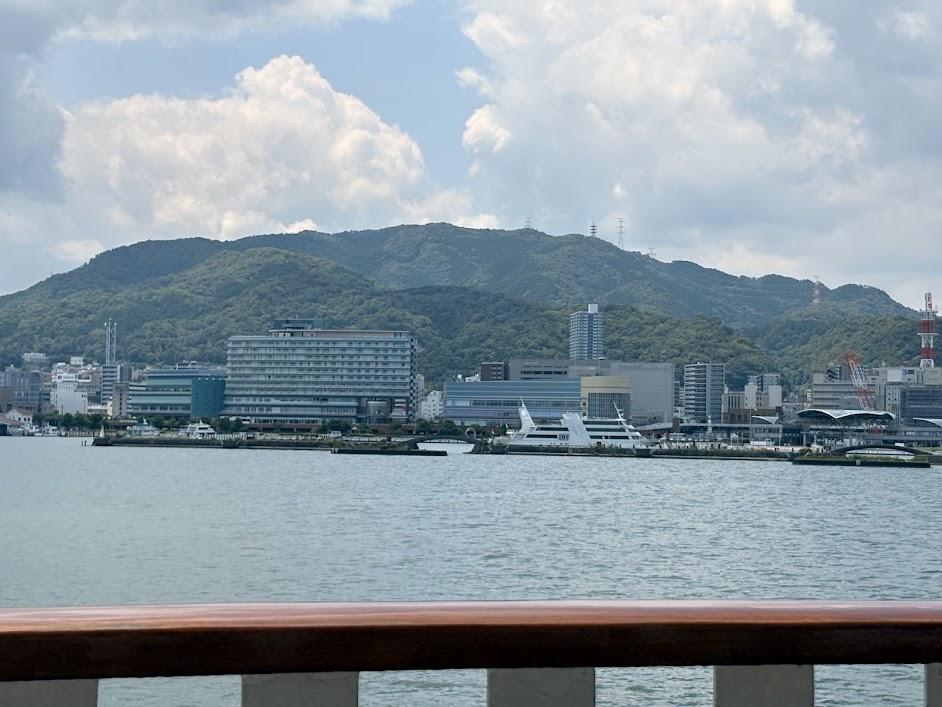
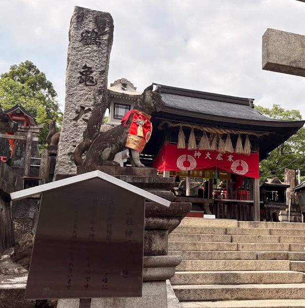

こんにちは！いとじゅんと申します！  
先日開催された関西Ruby会議09に参加してきました！新鮮なうちに参加レポートを投下します！！

https://regional.rubykaigi.org/kansai09/

## イベント全体の感想

Keynoteの成瀬ゆいさんとはすじょいさんを始めとした登壇者の皆さまの好きが溢れていて、見ている側だった私も**やっていき**が超高まったカンファレンスでした！また、登壇者の方が登壇するときに各々の選んだ個性あふれる囃子が流れていたのが、伝統芸能会館という場所にベストマッチで盛り上がれました！

関西の地域.rbのメンバーによって、カンファレンスが運営されている様子や各地域.rbから推薦された方がLTをしている様子から、関西の地域.rbの結束の強さが垣間見えてコミュニティの良さが出ていてとても良かったです！！

関西Ruby会議09のオーガナイザーの皆様、スポンサーの各企業様、登壇者の皆様、ありがとうございました！

## セッションの感想

素晴らしい発表の数々から個人的に好きだったセッションの感想を語ろうかなと思います。

### **「照らす技術」をRubyで照らす(**[**@harukasan**](https://x.com/harukasan)**)**

本セッションでは、ライブなどにおける舞台照明のうらがわで動いている「**照らす技術**」について解説されたうえで、デモをされていました。

デモの印象が強すぎますね。少しだけ動画を撮っていたので見直してみたのですが、あまりにもライブすぎる。

はるかさんのセッションのデモ

あんなの見せられたら買うしかないじゃない...

https://x.com/itojum1230/status/2078860873519829211

### **Project Naraku 外伝 —— レールロード図で照らすOnigmoのバグ(**[**@aim2bpg**](https://x.com/aim2bpg)**)**

犬夜叉のコスプレにめっちゃ笑いました。私も犬夜叉は履修済みなのでめちゃくちゃ懐かしかったです！

本セッションでは、自作正規表現エディタ「[Rubree](https://aim2bpg.github.io/rubree/)」によってOnigmoのバグを**照らし**、次にNarakuの開発環境の構築、NarakuのReDoS対策、パフォーマンスチューニングなどの試行錯誤について発表されていました。

私はこのセッションの初めにお話しされていたどういう経緯で正規表現と関わってきたのかというお話がとても楽しかったです。正規表現の沼にどうハマっていったのかが時系列順にお話されていて、「こうやって沼にはまっていくんだなぁいいなぁ」と思っていました。

私はOnigmoの問題点もNarakuも初見だったので、学びだらけでした！

https://speakerdeck.com/player/57d3aa38330c4e32ae1af97c5876c580

### **torikago - Ruby::Boxで照らすモジュラモノリスの実行境界(**[**@se4weed\_dev**](https://x.com/se4weed_dev)**)**

我らがnori先輩のセッション。

本セッションでは、モジュラーモノリスだと分離しきれない部分を、Ruby::Boxを使ってmoduleを分離する[torikago gem](https://github.com/se4weed/torikago)を紹介されていました。torikagoではmodule間の参照ルールをymlで定義し、参照してもよいモジュールやメソッドを宣言することができるらしいです。

良い面だけでなく、できないことやパフォーマンスへの影響も整理されていてとても良かったです。

torikagoが活躍できそうなでかいモジュモノしてるRailsアプリケーション...聞き覚えがありますね...

### **Rubyで未来を照らす 〜占いを実装する技術〜(**[**@ikoto\_me**](https://x.com/ikoto_me)**)**

本セッションでは、四柱推命という占いを[mirai gem](https://github.com/ikotome/meiri)として実装されておられました。

私は四柱推命という占いを初めて知ったのですが、セッション内での説明を聞けば聞くほど「これ関数だ！」となっていき、その後実際にGemとして実装した話があり、セッションの流れがきれいでした。

デモがうまくいかなくて参加者に投げられたので私はちゃんとやりきりました。えらい。

https://x.com/itojum1230/status/2078362310830338463

### Keynote ([@hsjoihs](https://x.com/hsjoihs))

もうね。怒涛の情報量の圧力に襲われていました。要約できるほど理解できてない...

定期的にこの資料を見て理解したいという気持ちを込めてここに備忘録的に置かせていただきます...

https://docs.google.com/presentation/d/1ZfueAQyVJsC2pmUYgIGdb_fmnFExYaCRnr9vcCf5uNk/embed

## おわりに

関西Ruby会議09、超楽しかったです！セッションはもちろん、コミュニティの熱狂や大津の魅力を味わえたカンファレンスでした！

やっていきが高まっているうちに参加レポートを書いて、私もカンファレンスで登壇したいなぁという気持ちになっております。今持っているネタ的には、PicoRubyKaigi 2026とRuby World Conferenceを狙っていきたいですねー！やっていきだ

Day2では、ミシガンクルーズを楽しんだり、京都の伏見稲荷大社の稲荷山を登山したりして帰りました！満喫した。

ミシガンクルーズ上から見る大津

稲荷山 山頂
