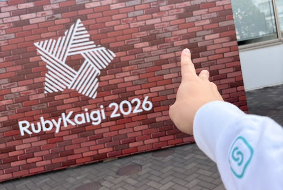
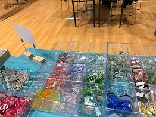
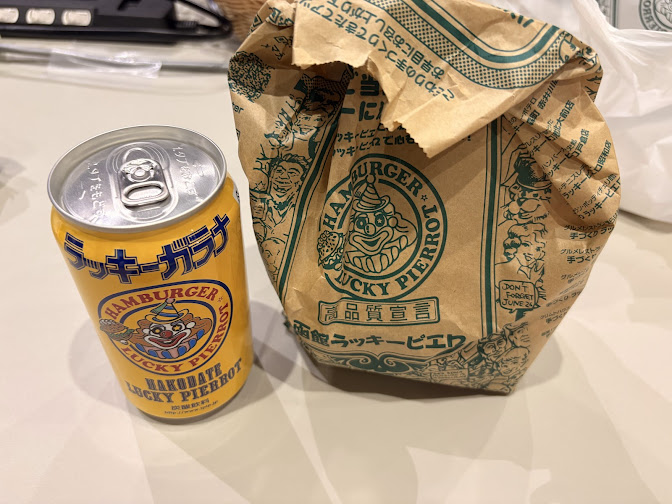
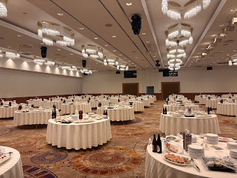
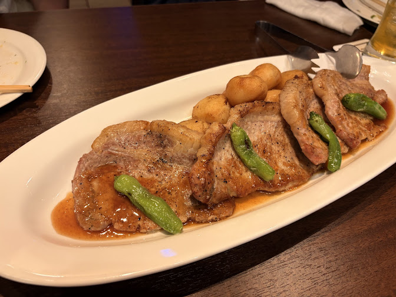

こんにちは！いとじゅんです！

先日函館で開催されたRubyKaigi 2026に参加してきました！！熱が冷めないうちに感想や学びをアウトプットしていきます！！

初日朝ピース

## 特に印象に残ったセッション

### The Journey of Box Building [@tagomoris](https://x.com/tagomoris)

Ruby 4.0に実験的に導入された機能である「Ruby Box」の基本機能や実装、開発するに至ったエピソードなどをキーノートして発表しておられました。

Ruby Boxに関してはLTでも[@joker1007](https://x.com/joker1007)さんがお話されていたようにモジュラーモノリスで利用するという用途に使えそうで面白いと感じました。私の会社では(私は関わっていないのですが)モジュラーモノリス化PJが進んでおり、そこに直結しような機能だと感じました。

このセッションで特に印象に残ったのはRubyBox開発に至ったエピソードです。「Multiverse Ruby」から刺激を受けて、開発に着手した話がとても面白かったです。自分にとっての「Multiverse Ruby」と出会えるかもとワクワクさせてくれた、このセッションはRubyKaigi 2026の最初のキーノートとしてこれ以上ない最高なセッションでした。

資料はこちら

https://speakerdeck.com/player/9775679efa3d42f1a497faec3b7d337d

### Funicular: A Browser App Framework Powered by PicoRuby.WASM [@hasumikin](https://x.com/hasumikin)

PicoRuby.WASM上で動作するWebアプリケーションフレームワーク「Funicular」についてのセッションです。  
私はWasmを触ったことがまだないのですが、そういう初心者でもわかりやすいようにPicoRuby.WASMの基本情報などを説明してくださったので、そのあとの話にも振り落とされずに聞くことができました。

Funicularによるアプリケーションのデモでは、簡素なコードでTODOアプリなどを実装しておられました。私はもともとフロントエンドをずっと開発していたので、Funicularをぜひ試してみたいと思いました。また今度試して記事を書くと思います。

このセッションで特に衝撃だったのはbinding.irbが動作していたことです。Wasmでbinding.irb！？！？これができるとPicoRuby.WASMでのフロントエンド開発時のデバッグのしやすさが跳ね上がるので衝撃でした。ここらへんの仕組みは資料を読み直してみたいと思います。

Lチカは情操教育

資料はこちら

https://slide.rabbit-shocker.org/authors/hasumikin/RubyKaigi2026/

### Ruby Releases Ruby [@hsbt](https://x.com/hsbt)

RubyやRubyGemなどのリリースに関わるCIツールや仕組みについてのセッションでした。普段何気なく使っている技術のリリースの仕組みをお話されておりとても興味深かったです。

リリースの仕組みをRubyで書くことを徹底することでドッグフーディングのようなことをしていたり、バックポート周りの話などがとても面白かったです。

Ruby 4.0に上げてバックポートの恩恵を受けていきたい。

## ブース

会社のブースの運営をしていたので、ゲームやモルックの説明、お菓子の提供などをしていました。

ブースの内側からの景色

シフト外の時間はセッションを見に行ったり、他のブースを回ったり、休憩スペースで雑談したりしていました。

お昼はANDPADさんのランチをいただきました。ごちそうさまでした！

ラッキーピエロのハンバーガー

## **Official Party & Drinkup**

Official Partyでは、はじめましての方とも交流できてとても楽しかったです！マグロの解体ショーを始めてみたのですがとても面白かったです！

一番乗りしたので誰もいないパーティー会場

Day2の夜はTOKIUM & mybestさんのDrinkupに参加してLTしてきました！  
ここで食べたジャガイモが美味しすぎて感動していた。

美味しすぎたジャガイモとお肉

Day3の夜はfreeeさんのDrinkupに参加しました！BINGOゲームがめっちゃ楽しかった！BINGOできなかった...

## 函館市電LT

Day4でSmartHRさんの函館市電LTに参加してきました！  
RubyKaigi 2026のセッションの内容を試してみた発表が多くて行動が早くて負けてられないなと思いました。

私もLTをしてきました！！！

https://x.com/tomio2480/status/2047849882262847898

後から聞いたら私のLTの区間は函館駅だったそうですごい注目を集めていたそうで、誇らしいですね。

資料はこちらです。

https://speakerdeck.com/player/195fecd4eb9d4f1fb622f7cccc544256

## おわりに

RubyKaigi 2026めっっっっちゃ楽しかったです！！！RubyKaigiの運営の皆さまや関わってくださったRubyistの皆さまに超ありがとうございました！

今回のRubyKaigi 2026でやってみたいことがたくさんできたので、試すと同時にブログを更新していくのでぜひ見に来てください！

ではまた。
