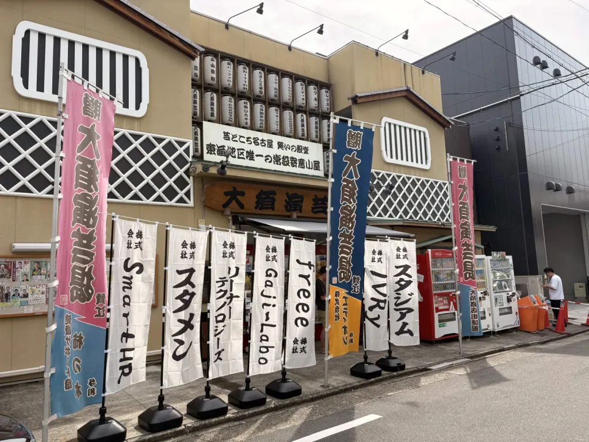
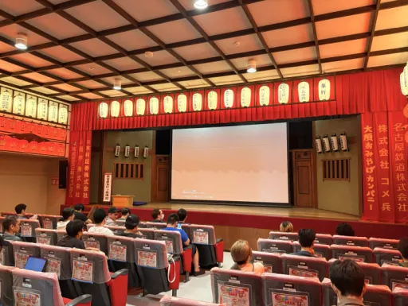

こんにちは！いとじゅんです。

  
2026年9月19日（土）、大須演芸場で開催された名古屋Ruby会議05に参加してきました。

名古屋Ruby会議は、名古屋のRubyコミュニティが主催する地域Ruby会議です。今回の会場である大須演芸場は、普段は落語などの演芸が行われている会場で、登壇者が発表するという、ほかではなかなか味わえない雰囲気のカンファレンスでした。

本記事では、名古屋Ruby会議05のセッションや感想などをお届けします！

大須演芸場の外観

ちなみに名古屋Ruby会議に参加するうえでいろいろバタバタしていてその時のことをまとめた別のブログを書きました。よければこちらもどうぞ。

## **特に印象に残ったセッション**

どのセッションも面白かったのですが、ここではセッションやLTの中から特に印象に残ったものを3つご紹介します！

### **System Test is dead, long live System Test /** [**Keita Urashima**](https://x.com/ursm)**さん**

このセッションでは、インテグレーションテストとシステムテストの違いをアクターの違いから整理し、前者は「値が想定どおり返るか」、後者は「ユーザーが想定どおり受け取れるか」を確かめるものだと説明されていました。また、システムテストが遅い主な原因はChromiumのような実ブラウザにあるとして、JSも扱える軽量な capybara-simulated でシステムテストを構築することを提案されていました。

普段の開発では、テストの種類ごとの役割を「なんとなく～」で分けてしまいがちでした。「誰の視点で何を確かめるテストなのか」というアクターの観点で整理されたことで、それぞれのテストの責務がすっきり理解できました。  

また、私も発表であったようにシステムテストはコストが重いので最小限にしたほうが良さそうだと思っていたので、そのコストの一端を解消できる選択肢を知れたのが良かったです！

Urashimaさんが自作されたcapybara-simulatedはこちらです。

### **型 再考 /** [**黒曜**](https://x.com/kokuyouwind)**さん**

このセッションでは、『Types and Programming Languages』をもとに型と型システムとは何かを整理したうえで、Rubyにおける型システムの歴史を振り返られていました。また、RBSがなぜ別の言語としてファイルやコメントに分離されているのかについても解説されていました。

「型 再考」というタイトルの意味が変わる、発表のオチもとても面白かったです！

発表資料はこちらですー！

<iframe src="https://slides.com/kokuyouwind/nagoya-rubykaigi-2026/embed" style="top: 0; left: 0; width: 100%; height: 100%; position: absolute; border: 0;" allowfullscreen="" scrolling="no"></iframe>

  

### **「ピッケル本」日本語版は4.0(第6版)が出版されるべき /** [**角谷信太郎**](https://x.com/kakutani)**さん**

このセッションでは、Ruby 3.3対応のピッケル本を翻訳している途中で原著のRuby 4.0対応版が出ることになった経緯や、翻訳書ならではの苦労をたくさん聞くことができました。

翻訳書の裏側にある苦労や判断の積み重ねを聞いて、一冊の本が世に出るまでにどれだけの労力がかかっているのかを実感しました。

書籍とコミュニティのつながりについてのお話を聞いて、応援したくなったので支援してみました。

> 名古屋Ruby会議の参加レポートを書いていて思い立ったので [pic.twitter.com/WGkXmK7Hl7](https://t.co/WGkXmK7Hl7)
> 
> — いとじゅん (@itojum1230) [September 23, 2026](https://x.com/itojum1230/status/2102778865320092112?ref_src=twsrc%5Etfw)

  

発表資料はこちらですー！

<iframe src="https://speakerdeck.com/player/6e0c3eeb36f54325a7fc0f67f651f4f7" style="top: 0; left: 0; width: 100%; height: 100%; position: absolute; border: 0;" allowfullscreen="" scrolling="no"></iframe>

## **全体の感想**

今回取り上げた以外のセッションやLTでは落語をオマージュした発表が多く、とても面白かったです！寄席という会場の特性を存分に活かした構成で、登壇者の皆さんの工夫に何度も笑わされました。落語そのものにも興味が湧いたので、今度は普通の寄席にも足を運んでみたいです。

懇親会では、台湾料理を食べながら名古屋の話やRubyConf Africaの話などができて楽しかったです！アフリカ、行こうかな…。

地域Ruby会議に参加するたびに、その土地ならではの色があって、今回の名古屋Ruby会議05も、会場・発表・懇親会のすべてに「名古屋らしさ」と「このイベントらしさ」が詰まっていて、参加して本当に良かったです。

運営・登壇者・スポンサー・参加者の皆さま、ありがとうございました！

