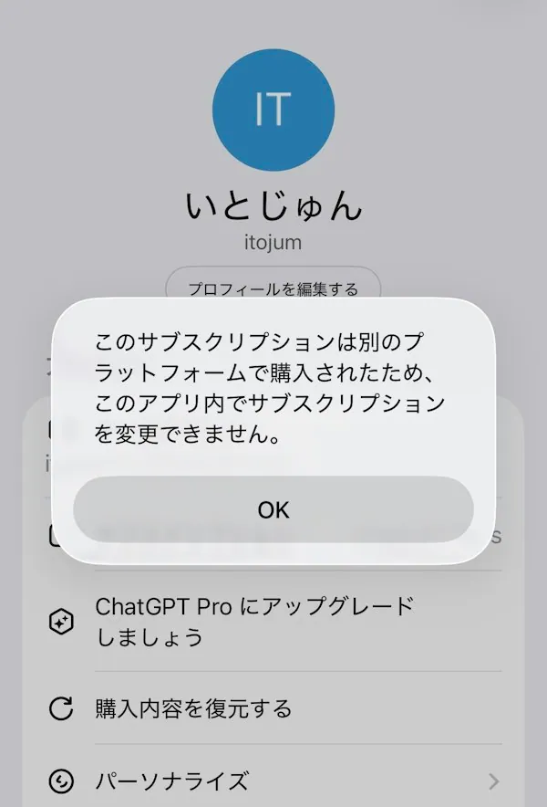
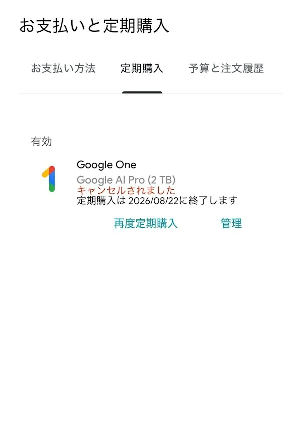
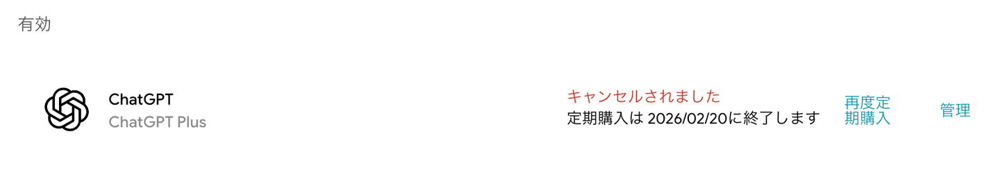

## 結論

- ChatGPTのサブスクは決済プラットフォームでしか管理ができない。
- ChatGPTの登録メールアドレスを途中で変えており、ChatGPTのサブスクが以前のGmailに紐づいていた。

## 背景

私は4月から新社会人になり、新生活が始まります。それにあたって、これまで雑にしていたサブスク周りを整理しようと思いました。

ChatGPTは現在Plusプランを契約中ですが、最近Goプランが出たのでPlusプランからGoプランへダウングレードしようと思っていました。

[https://openai.com/ja-JP/index/introducing-chatgpt-go/](https://openai.com/ja-JP/index/introducing-chatgpt-go/)

https://openai.com/ja-JP/index/introducing-chatgpt-go/

* * *

## 問題

最近乗り換えたiPhoneの方からChatGPTのプランをGoに変更しようとしたところ以下のように表示されました。

少し調べてみると、ChatGPTのサブスクは購入したプラットフォームでしか変更ができないとのこと。

私は少し前までGoogle Pixelを使用していたので、Google Playでしか管理ができないらしい。そこでChatGPTに紐づけられているGmailのアカウントでGoogle Playを見にいく。

定期購入のページを見に行くとChatGPTの項目はなく、学割分のGoogle Oneしかなかった。

## 原因

今回の原因は私がGoogle Playで使っていた旧GoogleアカウントとChatGPTに紐付けていた現Googleアカウントが違うことだった。

ChatGPTのメールアドレスを変更した後も決済は旧Googleアカウントで行われていたらしい。

旧GoogleアカウントでGoogle Playにログインし、見に行くとそこにはChatGPTの姿が。

無事キャンセルできた。どうやら、定期購入の終了までは別のプラットフォームでも購入できないっぽいので、終了まではPlusプランを使って、気が向いたときにGoプランにアップグレードしようと思う。

## 最後に

ChatGPTが決済プラットフォームじゃないと管理できないというのは、調べると一瞬で分かったのですが、Googleアカウントを切り替えていたせいで少し手間取ってしまいました。ではまた。
