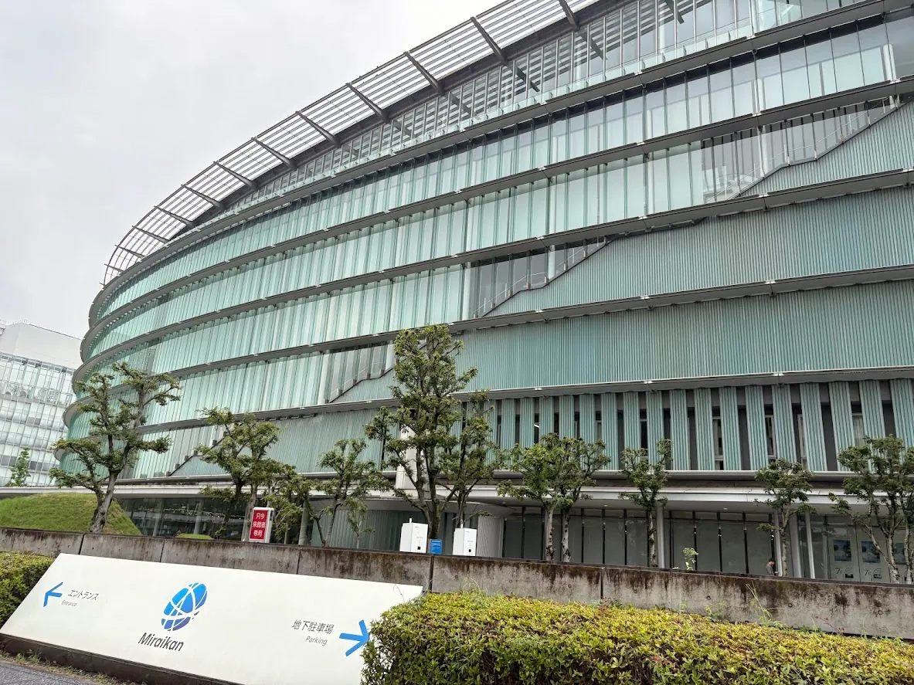

こんにちは！いとじゅんです！

今日、きのこカンファレンス2026に参加してきたので、参加レポートを書きました！！

会場の写真

## 印象に残ったセッション

自社のブースの運営したり、ブース回ったりしていたのでセッション自体はあまり拝見できなかったのですが、拝見したセッションの中でも印象に残ったものを紹介します。

### 推しは推せるときに推せ！ライフステージ変化に向き合う ([@katzchum](https://x.com/katzchum))

https://www.docswell.com/slide/ZQ22LM/embed

runnとの出会いからOSS貢献、登壇と一気に世界が広がったのが、発表からひしひしと伝わってきてよい話だ...となっていました。

周りのエンジニアとお話ししていて、ライフステージの変化によってOSSやコミュニティ活動へのコミットが減るという話を聞いていたので、それを乗り越えた話はとても参考になりました。

これが真理だなーと思いますね。

https://x.com/itojum1230/status/2071073466460291214

### "詰む"前に仕組みを作れ ー 技術の波に溺れないためのキャッチアップ術 ([@zinbe](https://x.com/zinbe))

https://speakerdeck.com/player/ccdb86861be04395a318dbb7940ee2d0

キャッチアップができていないと起こる状況や詰みが、今の私の状況にドンピシャで思わず聞き入ってしまいました。

インプットしてアウトプットするということは意識してやっていたのですが、**フィルタリング**というステップはあまり意識していなかったので参考になりました。一個気になったのは、発表者の杉山さんはどんな捨てる基準を持っているのかです。直接聞けばよかったのですが、残念ながらタイミングがなかった...。

キャッチアップする方法を仕組化して、受動的でも自然と情報が入ってくる状態にするのはやっていかないとなぁと思っていたので、良いきっかけになりました。明日にでもやりたい。

## 自社のブース運営

私の勤務先のS社はスポンサーをしていて、ブースを出すことになっていたので、ブース運営をしていました。

増えてくアクキーというノベルティを配布していました！！会社の説明をもう少しできればよかったなぁという反省。

https://x.com/kinoko_conf/status/2071110608142172429

## 転職ドラフトさんのノベルティが面白かった！

転職ドラフトさんのブースでエンジニアのキャリア診断をしました！！転職ドラフトらしくて良いなと思いました！私は「自分らしさタイプ」でしたね。

ノベルティでバジルの栽培セットをいただきました！めっちゃ好き。なんでバジルなんだろうか。聞けばよかったですね。

https://x.com/itojum1230/status/2071126304897061296

## おわりに

> ブログを書くまでがカンファレンスです

とのことだったので、今回のブログで私にとってのきのこカンファレンス2026は終了です。

キャリア特化のカンファレンスは初めてだったので、新鮮で楽しかったです！

次回のきのこカンファレンスは2028？らしいのでまだ再来年！

https://x.com/itojum1230/status/2071168867716706323
