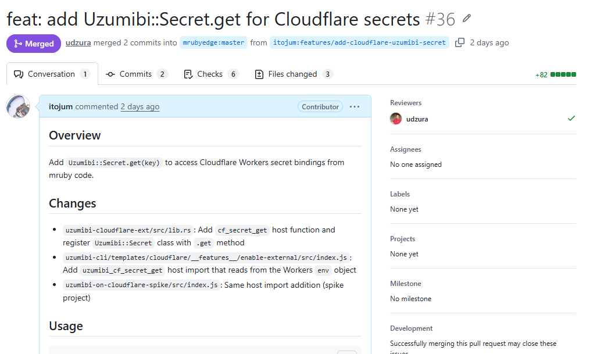

こんにちは！いとじゅんです！  
今回はRubyKaigi 2026で[@udzura](https://x.com/udzura)さんが発表されていたUzumibiでDiscord Botを作ってみました！  

Rubyで個人開発をしようと思った時に、毎回どこにデプロイしよう？となって諦めていた私にとって、CloudflareなどにRubyのWebアプリケーションをデプロイできるUzumibiは革命的に見えたので試してみました！

今回、UzumibiでDiscord Botを作る上で、以下のドキュメントに助けられました。ありがとうございました。そもそもUzumibiとは？という方は以下のドキュメントがわかりやすくまとめられているのでおすすめです。

[](https://zenn.dev/udzura/books/532f38f73fe4e9)

<script async="" src="https://iframely.net/embed.js" charset="utf-8"></script>

## 作れたもの

Interactions方式のDiscord Botを作りました。今回はピンポンするだけの簡単なものを開発しました。


Discord Botが動いた

[https://github.com/itojum/ruby-discord-bot](https://github.com/itojum/ruby-discord-bot)

## 苦労したこと

### 環境変数

Uzumibiは現在Cloudflareの環境変数を読み込む方法がなさそうでした。(実装ロードマップにはある。PR出そうかと思ったんですが、各プラットフォームに対応した実装をして検証するには時間がなかったので見送り)

しかし、Discord Botを作成する上で、Public Keyを渡す必要があります。

UzumibiはRustとJavaScriptによるグルーコードによって、Wasmモジュールから各プラットフォームやJS固有のAPIにアクセスしているので、これを実装してあげることで環境変数を参照できるようにしました。

Wasmも初めて、Rustも初めてでなんもわからんかったので、AIに頼りきりになってしまいました。

Rubyからの呼び出し

```ruby title="lib/app.rb#L8"
public_key = Uzumibi::Secret.get('CLIENT_PUBLIC_KEY')
```

JavaScriptで環境変数を取得して、Wasmメモリに書き込むコード

```javascript title="src/index.js#L222"
// Secret.get(key) -> value string (secrets are env bindings in Cloudflare Workers)
uzumibi_cf_secret_get: (keyPtr, keySize, resultPtr, resultMaxSize) => {
  const memory = exports.memory;
  const key = decoder.decode(new Uint8Array(memory.buffer, keyPtr, keySize));
  const value = env[key];
  if (value === undefined || value === null) return -1;
  const valueBytes = encoder.encode(String(value));
  const length = Math.min(valueBytes.length, resultMaxSize);
  new Uint8Array(memory.buffer, resultPtr, resultMaxSize).set(valueBytes.slice(0, length));
  return length;
},
```

以下はUzumibi::Secretを定義しているRustコード

```rust title="wasm-app/src/lib.rs#L90"
    let uzumibi_module = vm.get_module_by_name("Uzumibi");
    let secret_class = vm.define_class("Secret", None, Some(uzumibi_module));
    mrb_define_class_cmethod(
        &mut vm,
        secret_class,
        "get",
        Box::new(|vm, args| {
            let key = mrb_funcall(vm, args[0].clone().into(), "to_s", &[])?;
            let key: String = key.as_ref().try_into()?;
            match cf_secret_get(&key) {
                Some(val) => Ok(RObject::string(val).to_refcount_assigned()),
                None => Ok(RObject::nil().to_refcount_assigned()),
            }
        }),
    );
```

## おわりに

今回はUzumibiでDiscord Botを作ってみた話をしました。

最初こそAIがよくわからんコードを出してきて、なんか動いたとしか思ってなかったのですが、ブログを書くうえでコードを読んだ時、割と理解できたのは成長かなと思いました。コードが短いのもある。

何か思いついたら遊んで、またブログにしたいですね。

ではまた。

## 追記

追加したUzumibi::Secret.getをUzumibiへPRを送り、マージしてもらいました🎉



マージしていただいたPRのスクリーンショット
