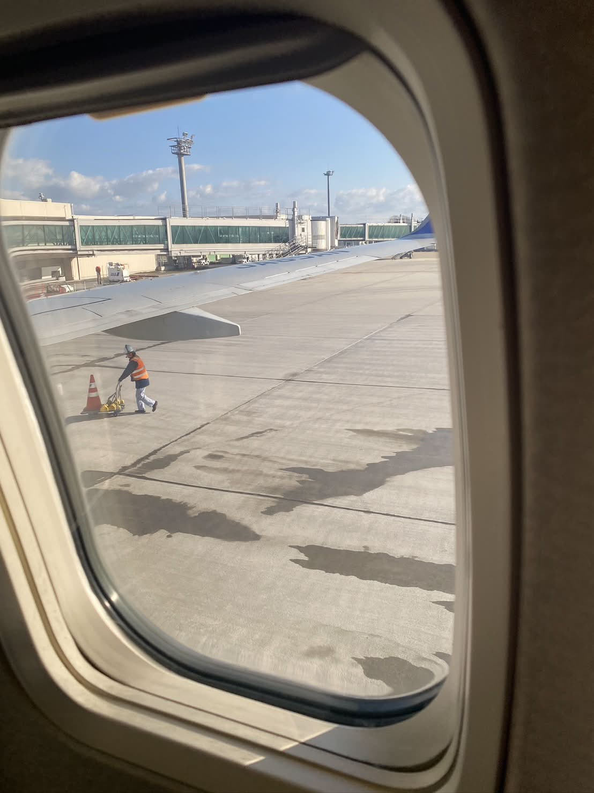
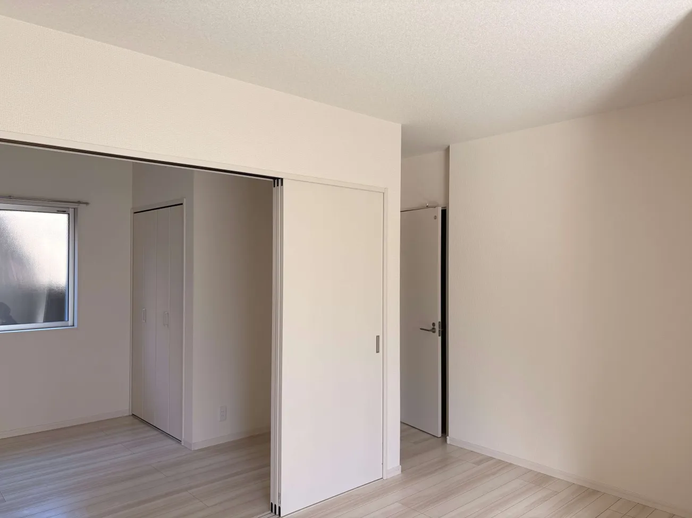
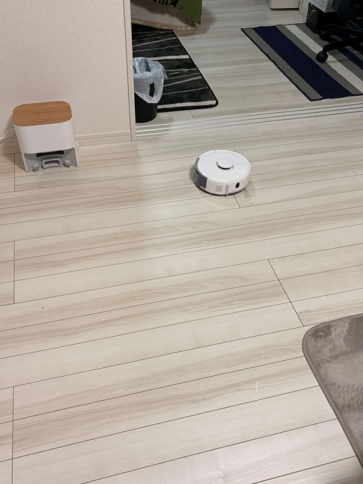
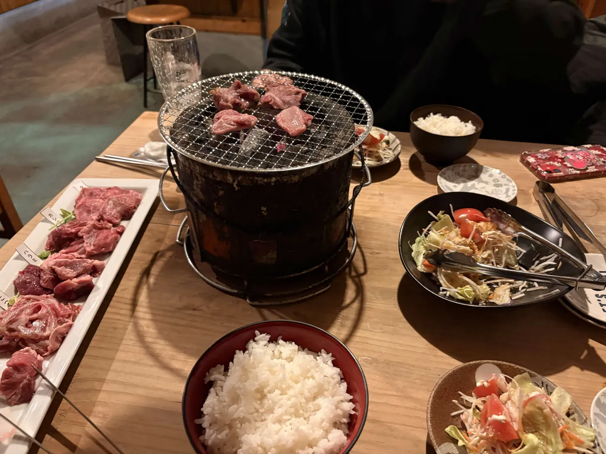

## はじめに

新卒エンジニアとなるために埼玉へ引越ししました。日記がてら引越しの初日をダラダラと書いていきます。ブログを書く習慣をつけるのも目的です。

## 初日

### 人生初の飛行機

[米子鬼太郎空港](https://www.yonago-air.com/)から人生初の飛行機に乗り、母と共に羽田空港へ飛びました。保安検査がよくわからず、「そろそろ締め切りますー」と言われた駆け込みました。米子だからこれでも間に合いましたが、羽田空港から飛ぶ時は、もっと余裕を持って行こうと思いましたまる

今まで新幹線でしか東京へ行ったことがなかったので、飛行機が1時間半程度で着くのに感動。1ヶ月以上前にチケットを取れば、新幹線より安いので今後は飛行機で移動するかな。

飛行機の窓からの写真

### 搬入

羽田空港から埼玉へ電車で移動し、不動産会社へ到着。鍵の受け取りと入居説明を受け、新居へ移動しました。

搬入前の新居の写真

広い。

到着早々、サカイ引越センターの方が来られたので搬入が始まりました。家具の組み立てまでしてくれて大変助かりました。搬入終了後は**10分サービス**で10分間お手伝いしてくれるとのことだったので、ダンボールの開封をしてもらいました(カッターを持ってきていなかった)。地味に助かるサービス。

## 荷解き

母親が手伝ってくれたので、1日目のうちに荷解きは全て終了。注文してまだ届いていない家具・家電があるので、微調整はあるものの、ほぼ落ち着きました。荷解きで出たダンボールは、たまたま工具を忘れて次の現場に行ってしまって、取りに来たサカイ引越センターの方に持っていってもらいました。

ダンボールがなくなり、床から荷物が消えたので、買っていたSwitchBotのロボット掃除機「そぼろ」(命名:母)を稼働してみました。かわいい。

労働させられるそぼろくん

### 買い物と夕食

荷解きが終わった後、母と近くのスーパー2店舗を見に行きました。1店舗はパチンコ店に直結しており、あまり雰囲気が好きじゃなかったので近寄らないかな。もう1店舗は中にダイソーが入っており、便利そうなので結構行きそう。また、月額900円程度でネットスーパーが個別送料なしで使えるサービスをしているらしく、めちゃくちゃ気になっている。使い始めたら本格的に運動不足で死にそう。

どうしても飲みたかった母とホルモン焼き居酒屋へ

## その後

2日目は買い出しに奔走し、3日目は母が行きたかったインク屋や絵描きカフェ、シルバニアファミリーショップへ行きました。3日目の最後に母を新宿のバスターミナルへ送り届け、お見送りしました。

## 最後に

今回は引越しをほぼ母に手伝ってもらいましたが、次回の引越し(多分2年後？)は、自分一人で引越しをすることになると思うので、なんとか頑張ろうと思いました。

以上ー。
