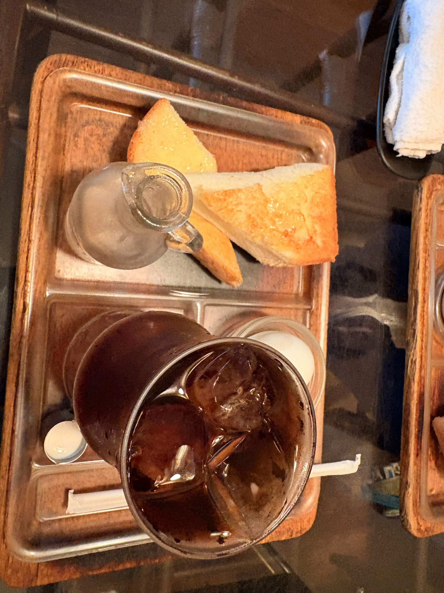
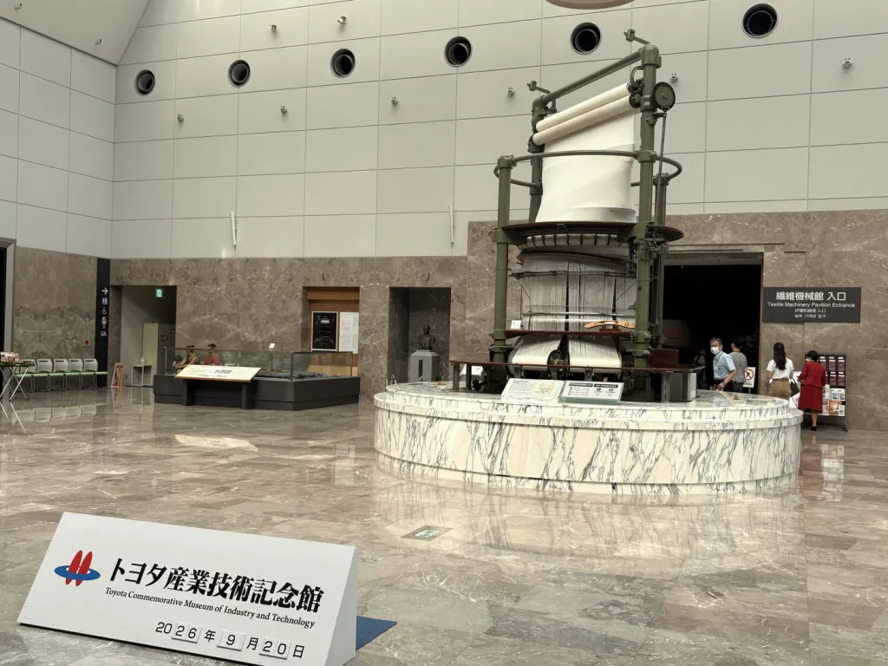

2026年9月18日、明日開催される名古屋Ruby会議に参加するため、私は名古屋へ向かった。それが2日間にわたる苦難の始まりだった...

この記事は、名古屋Ruby会議に参加しようとしたエンジニアが苦しんだ記録である。

## **第一章: 高速バス**

時は9月18日、世間はシルバーウィークの到来によって活気に満ちていた。さらに、名古屋ではアジア競技大会が開催されるということでとても混雑することが予想されていた。

これによって、新幹線のチケットは取れなかったのである。のぞみは全席指定席で、ひかりやこだまを使っても長時間立つのはつらいという状況。私は高速バスという選択肢を取った。これが一つ目の過ちである。

シルバーウィーク初日の混雑は新幹線だけでなく、道路上も同様であった。高速バスは渋滞に巻き込まれ、最終的に90分の遅延。私はなぜか終電ぎりぎりに名古屋に到着し、電車でホテルに移動するという余裕のない予定を組んでいたので、見事終電を逃してしまう。

3時間歩けば着く場所だったが、現在時刻は0時。明日もあるため、早々に歩いて向かうのはあきらめ、人生で初めてタクシーを呼んだ。タクシーの運ちゃんとお話しするのは楽しかった。7,000円かかった。

## **第二章: 名古屋Ruby会議へ向かう道**

時は9月19日、私は名古屋Ruby会議に向かうため、電車に乗り込んだ。なんと、始発駅だったので座ってのんびり向かうことができた。降りる駅を間違えそうになりつつも、目的の駅へたどり着いた。

次にバスへ乗り込み、会場の最寄りのバス停まで向かい、知り合いのRubyistと合流した。合流したとき、違和感に気づく。AirPodsのケースがないのである。焦った私は「探す」アプリを起動し、離れていくAirPodsを確認した。バスはもう出発していた。泣き崩れそうになった。

朝ごはん

## **第三章: AirPodsを追いかけて**

時は9月19日、名古屋Ruby会議の最中。探すアプリからの通知が来た。なんとAirPodsが近づいてきたのだ。焦っていた私は知り合いに荷物を任し、同僚に声をかけ、AirPodsを追いかけた。

明らかにAirPodsはバスに乗ったままであったため、路線を調べ先回りすることにした。ここ問題になったのが、探すアプリの更新頻度である。5~10分間隔で更新されるAirPodsの位置情報。どこにいるのかを予測しながら走り回った。

信号待ちをしている間に目の前を件のバスが走り去ったり、バスは始発まで帰ってしまったりしたが、折り返してくるのを待った。そして、乗り込むことに成功し、AirPodsを探したところ、運転手さんが回収してくれていた。

しかし、一度回収してしまったら、営業所でないと返すことはできないと言われ、降ろされてしまったのだ。(改めて考えるとまぁ無理だよね)

## **第四章: 名古屋Ruby会議が終わって**

時は9月19日、名古屋Ruby会議が終わった。懇親会までは1時間。バス会社の営業所に向かった。地下鉄に乗り込み、行くこと20分。ついにAirPodsのケースを回収することに成功したのだ。歓喜に震えた。

意気揚々と地下鉄に乗り込み、懇親会会場に向かった。

懇親会会場はそこそこ長い行列ができていた。これ全員Rubyistか？と思った私は列の最後尾に移動した。しかし、様子がおかしい。明らかに年齢層が若いのである。Rubyistではないなと思った私は、Xで情報収集することにした。すると、別口があるらしいことを知った。ついに、懇親会会場にたどり着いたのである。

## **おわりに**

細かいやらかしとか不運はほかにもいろいろあったが、大きな流れとしては以上である。

すべてノープランの旅をしたいというこだわりと確認不足が原因であり、もう少しちゃんとしようと反省するばかりだ。

次回遠出するのは、北陸Ruby会議か仙台Ruby会議かRubyWorld Conferenceだと思われる。RubyWorld Conferenceは地元なのであまり心配していないが、北陸や仙台に行くことになったら今回の反省を活かし、計画を綿密に行うつもりだ。

日曜日に見に行ったトヨタ産業技術記念館
