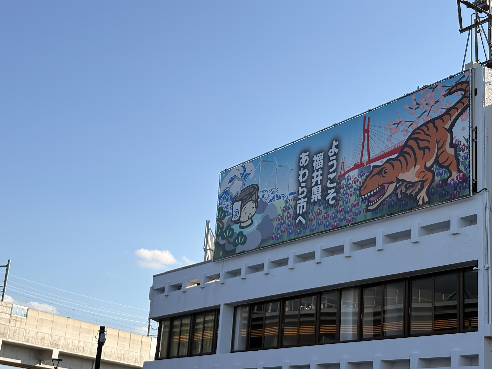
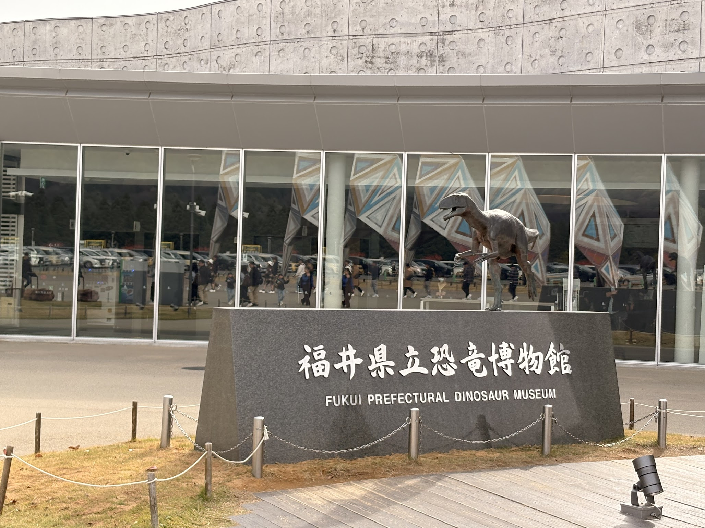
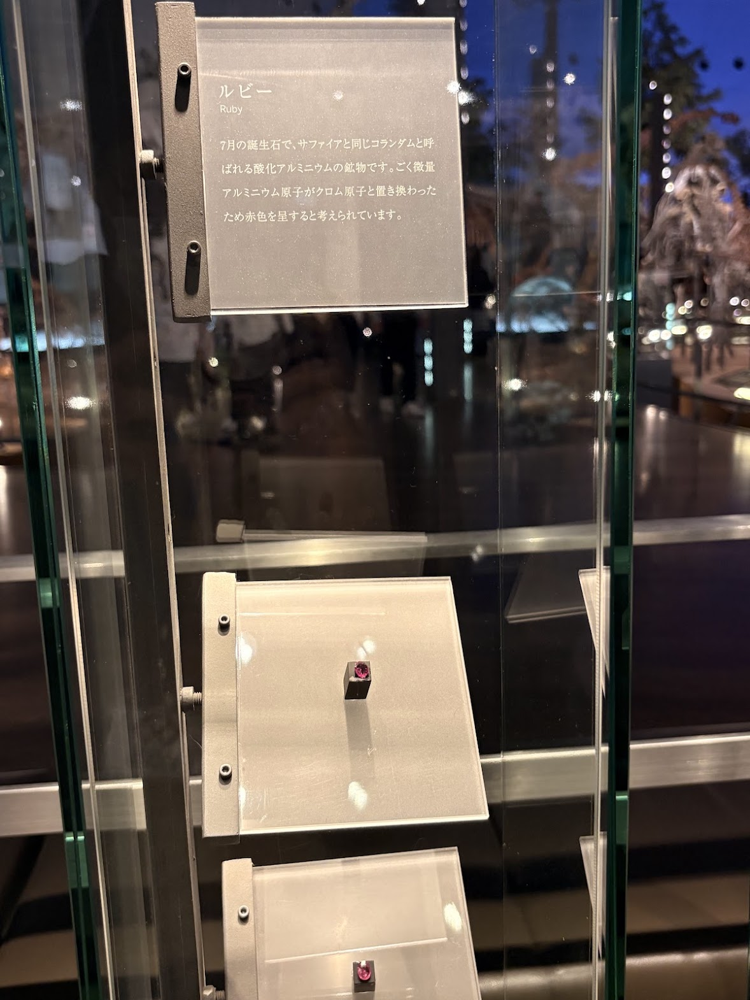

こんにちは！いとじゅんです。

2026年11月14日(土)に福井県立恐竜博物館で開催された北陸Ruby会議02に参加してきました。

https://regional.rubykaigi.org/hokuriku02/

テーマは、「発見」。多くの化石が発見されている福井県に準えたテーマとなっていました。各発表者の方が発見や化石要素を取り入れた発表をされていました。

このブログでは北陸Ruby会議02へ旅の流れ、本編、感想などをお届けします。

## 参加前

北陸Ruby会議の会場である福井県立恐竜博物館は駅からも遠くアクセスがあまり良くないこともあり前日入りすることにしました。しかし、福井市でライブと重なってしまい、ホテルがとんでも高騰していたので、ちょっと離れたあわら温泉に泊まることになりました。

駅前の写真。もう恐竜がいた

近かったので東尋坊の夕焼けを見に行きました。音声ガイドを聞いていたのですが、なんかずっと物騒で面白かったです。下のX埋め込みだと肝心の夕焼けが見えてないので、Xに遷移してみてほしい。めっちゃ綺麗なので。

https://x.com/itojum1230/status/2121144750321607020

## 会場：恐竜博物館

恐竜博物館の写真を何個か貼りますー。楽しかった。

往路で乗ったあわら恐竜号。Rubyistと出会った

きたぜ

本日の主役

## 本編

### [gem install と require のむこうがわ](https://regional.rubykaigi.org/hokuriku02/#SESSION-1) (ydah san)

https://x.com/ydah_/status/2121471491988705755

gem installとrequireが実行されたとき、裏側でどのような処理が行われているかをseccompのuser notificationでシステムコールを実行前に受け取り、Ruby 側で記録して観測するセッションでした。公開Gemを調べると、installの一部が失敗しても成功扱いになるケースや、requireしただけでコマンドを実行するケースが見つかったそうです。

私も会社でGemを開発する側にいるので、自分たちのGemを社内のプロダクトで使ってもらう以上、require時の副作用や、失敗を成功として扱わないといった点を自分事として聞いていました。そのうえでいちばん印象に残ったのは、締めの人が集まり人の話を聞くことで新たな発見があるという言葉でした。最近AIの発展でカンファレンスの形も変化していくと思うのですが、この点は変わらないんだろうなと感じました。

### [あなたはMCPの機能を、まだ知らない。](https://regional.rubykaigi.org/hokuriku02/#SESSION-2)(**内西 功一 san**)

https://x.com/_4geru/status/2121491821130072087

MCPの中でもまだあまり知られていない、MCP Appsの機能を紹介するセッションでした。関西Ruby会議09で発表しておられた「[Rails で Remote MCP サーバーを作った話](https://speakerdeck.com/4geru/rails-de-remote-mcp-sabawozuo-tutahua-266db767-a8d7-4d27-8fe3-0a31ff3956c2)」に続いて、今回はMCP Appsの基礎からClaudeでガチャが回せるMCP サーバーなどのデモを発表しておられました。MCP Appsを使うと、ツールがGUIを返してチャットの中に表示できることを、TRICKのコードをruby.wasmで動かすデモで見せておられました。

私は学生のころにMCPサーバーを作って遊んだことがありましたが、最近はあまり最新情報を追ってはいませんでした。今回の内容であるMCP Appsのことはほぼ知らず、まさにタイトルどおり「まだ知らない」機能でした。自分でも MCP Apps を作ってみたいと思いました。

### [コード生成時代のAPI定義を支えるRequest Spec移行](https://regional.rubykaigi.org/hokuriku02/#SESSION-3) (**pvcresin san**)

https://x.com/pvcresin/status/2121465669074231672

コード生成の時代にAPI定義をどう正しく保つかを、Eightでの取り組みから紹介するセッションでした。コード生成時代というのは、AI生成という意味ではなく、OpenAPIなどによる決定論的なツールによるコード生成です。

EightではモバイルアプリがAPIのクライアントコードをOpenAPIのコード生成に移行したことで定義と実装のずれが表に出て、開発中にクラッシュが起きたことをきっかけに、Request Specへ移行・スキーマ検証を入れて定義と実装のずれをなくす取り組みをされたそうです。さらに開発環境でCommitteeのミドルウェアを動かし、スキーマ違反をSlackに通知することで、ずれを見つけ続ける仕組み作りをされていました。

私がいちばん印象に残ったのはCommitteeとSlack通知の仕組みでした。テストの整備などで一回定義と実装のずれをなくしただけでなく、開発環境で動かしながらずれを拾い続けるという発想が良いなと思いました。

### [diff の範囲だけ実行時トレースすると、コードレビューに役立つのでは？](https://regional.rubykaigi.org/hokuriku02/#SESSION-4)(**笹田耕一 san**)

https://x.com/koichisasada/status/2121483402520219961

プログラムの観察方法を、どう動くのか（未来）、どう動いているのか（今）、どう動いたのか（過去）の3つに整理するところから始まり、実行時トレースツールのlumitraceを紹介するセッションでした。

Rubyのコードを実行すると、Prismで生成したノードに情報収集(値・型など)を差し込んで、「何回目の実行時のnは何だったか」といった式ごとの値や型を記録できるそうです。さらに、これをすべてのコードに記録すには重いので、git diffの範囲だけに絞るという発想でした。

今の時代、コードレビューの時に使える情報源として人間にもAIにもこういうツールがあると便利だと思いました。自分の書いたコードの動きを確かめられるので、学習用途にも良さそうです。

### [Paint it Red!](https://regional.rubykaigi.org/hokuriku02/#SESSION-5) (**S.H. san**)

https://speakerdeck.com/player/3d2917af6f52441ca66ccf8d283cf3a3

普段使っているものの裏側を再発見したいという動機から、カーネルからHTTPサーバーまですべてをRubyで実装し、赤く染め上げるというセッションでした。PicoRubyKaigiで発表されていた「[PicoRubyではじめる自作カーネル入門](https://speakerdeck.com/gamelinks007/picoruby-dehajimeru-jisaku-kaneru-nyuumon)」の続編的な発表でした。HTTP サーバーには picoruby-socket を使い、WEBrick なども同梱した Kurenai を作っておられました。最後にはFunicularやテキストエディタまですべてをRubyに染め上げておられました。

すべてをRubyに赤く染めてしまおうという発想がとても面白く、低レイヤーなところからRubyで染め上げていくことで裏側を見えてくるのだと感じました。

### [テストだけで見つかる？ Rubyでつくるメソッド発掘器](https://regional.rubykaigi.org/hokuriku02/#SESSION-6)(**井澤ゆきみつ san**)

https://x.com/Yukimitsu_Izawa/status/2121494613852930156

`[1, 2, 3].??? == 1` の`???` に入るメソッドを値と返り値から探すメソッド発掘器を紹介するセッションでした。`[2, 1].??? == [1, 2]` では sort や reverse など7つの候補が出るが、入力を変えると sort と sort! の2つまで絞れ、さらに元の配列が変わるかどうかで見分けられる、という流れで発掘を進めておられました。最後には、テストを通るが要求に合わない実装をわざと書いて、その実装で通らないテストを考えるというのを提案しておられました。

会場で一緒に考えながらクイズを楽しんでいました。Rubyのメソッドへの理解が足りてないなと感じ、今回の発掘器は学習用途にも使えそうだと思いました。実際に触って遊んでみたいです。

### [KEYNOTE: Dig it!](https://regional.rubykaigi.org/hokuriku02/#KEYNOTE-1)(**うなすけ san**)

https://x.com/yu_suke1994/status/2121921682759991319

うなすけさんの来歴（クラウドゲーミングからQUIC、RubyKaigi）へつながらう深めの自己紹介から始まる基調講演でした。メインはネットワーク系の基礎知識から始まり、QUICのRFC 8999を読み解いていく内容でした。基礎から丁寧に整理してくださったので、私はネットワークは授業でやった程度だったのですが振り落とされずについていくことができました。

プロトコルのOssification(骨化、恐竜博物館要素)やそれの対策としてのGreasingは工夫の仕方が面白いと思いました。さらに、特に印象に残ったのは、なぜRubyでQUICの実装などをしているかという理由で、「Rubyが使われ続ける」ためというものです。自分も Ruby が使われ続けるために何ができるのか、考えていきたいと思いました。

## 感想

まずは、北陸Ruby会議02を開催してくださった運営の皆さま、登壇者の皆さま、参加者の皆さまへ、楽しい北陸Ruby会議02をありがとうございました。

発表内容はもちろん、福井、恐竜博物館、懇親会などめちゃくちゃ楽しいカンファレンスでした！！また次回の北陸Ruby会議も参加したいですね。

なんとかサウルスの写真。構図がすごく好き
